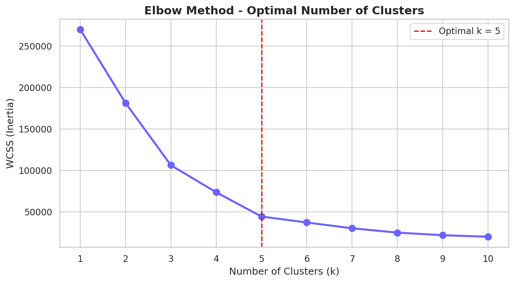

<h1 align="center">🛍️ Mall Customer Segmentation</h1>

<p align="center">
  
  
  
  
</p>

<p align="center">
  Unsupervised Machine Learning project using <strong>K-Means Clustering</strong> to segment mall customers based on their annual income and spending behaviour — enabling data-driven marketing decisions.
</p>

---

## 📌 Problem Statement

A mall wants to understand its customer base better. By grouping customers into meaningful segments, the marketing team can design **targeted campaigns** for each group — instead of sending the same generic message to everyone.

**Goal:** Use clustering to identify which types of customers exist and what differentiates them.

---

## 📊 Dataset

| Feature | Description |
|--------|-------------|
| `CustomerID` | Unique customer identifier |
| `Gender` | Male / Female |
| `Age` | Customer's age |
| `Annual Income (k$)` | Annual income in thousands of dollars |
| `Spending Score (1-100)` | Score assigned by the mall based on purchase behavior |

- **Source:** [Mall Customers Dataset – Kaggle](https://www.kaggle.com/datasets/vjchoudhary7/customer-segmentation-tutorial-in-python)
- **Size:** 200 customers, 5 features

---

## 🔍 Project Workflow

```
Data Loading → EDA → Feature Selection → Elbow Method → K-Means Clustering → Visualization → Insights
```

---

## 🧠 Methodology

### 1. Exploratory Data Analysis (EDA)
- Checked for missing values (none found)
- Visualized age, income, and spending score distributions
- Gender breakdown: ~56% Female, ~44% Male
- Correlation analysis between all numeric features

### 2. Feature Selection
- Used **Annual Income** and **Spending Score** — the two most behaviorally meaningful features for segmentation

### 3. Elbow Method
- Iterated K from 1–10 and plotted WCSS (Within-Cluster Sum of Squares)
- Identified the "elbow" at **k = 5** as the optimal number of clusters

### 4. K-Means Clustering
- Algorithm: `k-means++` initialization (smarter, reduces convergence issues)
- Trained with `k=5`, `random_state=42`

---

## 🎯 Customer Segments Identified

| Cluster | Segment Name | Income | Spending | Recommended Strategy |
|---------|--------------|--------|----------|----------------------|
| 🟢 1 | Careful Shoppers | Low | Low | Budget deals & discounts |
| 🔵 2 | Conservative Spenders | High | Low | Premium upselling |
| 🟡 3 | Standard Customers | Mid | Mid | Loyalty rewards programs |
| 🟣 4 | Impulsive Buyers | Low | High | Flash sales & limited-time offers |
| ⭐ 5 | Target Customers | High | High | VIP / Premium memberships |

> **Cluster 5** is the most valuable segment — high earners who spend freely. **Cluster 4** shows impulsive spending behavior despite lower income — great for time-sensitive promotions.

---

## 📈 Key Visualizations

### Elbow Curve
Determines optimal `k` by finding where WCSS reduction starts diminishing:



### Customer Cluster Plot
5 clearly separated groups visualized with centroids (✕):


---

## 🚀 Getting Started

### Prerequisites
```bash
pip install pandas numpy matplotlib seaborn scikit-learn jupyter
```

### Run the Notebook
```bash
git clone https://github.com/YOUR_USERNAME/mall-customer-segmentation.git
cd mall-customer-segmentation
jupyter notebook customer_segmentation.ipynb
```

---

## 📁 Project Structure

```
📦 mall-customer-segmentation
 ┣ 📊 Mall_Customers.csv             # Raw dataset
 ┣ 📓 customer_segmentation.ipynb    # Main analysis notebook
 ┣ 📁 assets/
 ┃ ┣ 🖼️ customer_segments.png        # Cluster visualization
 ┃ ┗ 🖼️ elbow_curve.png              # Elbow method plot
 ┣ 📄 requirements.txt               # Python dependencies
 ┣ 📄 README.md                      # This file
 ┗ 📄 LICENSE
```

---

## 🛠️ Tech Stack

| Tool | Purpose |
|------|---------|
| Python 3.9+ | Core language |
| Pandas | Data manipulation |
| NumPy | Numerical computation |
| Matplotlib / Seaborn | Data visualization |
| Scikit-learn | K-Means clustering |
| Jupyter Notebook | Interactive analysis |

---

## 💡 Future Improvements

- [ ] Apply clustering on all 4 features (Age, Gender, Income, Score) using dimensionality reduction (PCA)
- [ ] Try other clustering algorithms: DBSCAN, Hierarchical Clustering
- [ ] Build an interactive dashboard with Streamlit or Plotly Dash
- [ ] Evaluate cluster quality using Silhouette Score
- [ ] Deploy as a REST API with FastAPI

---

## 📚 References

- [K-Means Clustering – Scikit-learn docs](https://scikit-learn.org/stable/modules/generated/sklearn.cluster.KMeans.html)
- [Mall Customers Dataset – Kaggle](https://www.kaggle.com/datasets/vjchoudhary7/customer-segmentation-tutorial-in-python)

---

## 📄 License

This project is licensed under the **MIT License** — see the [LICENSE](LICENSE) file for details.

---

<p align="center">Made with ❤️ by <strong>Kailash</strong></p>
